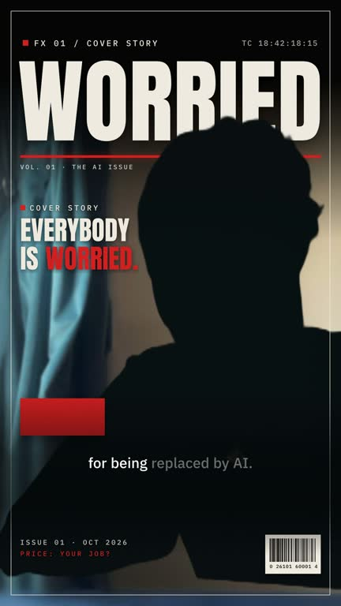
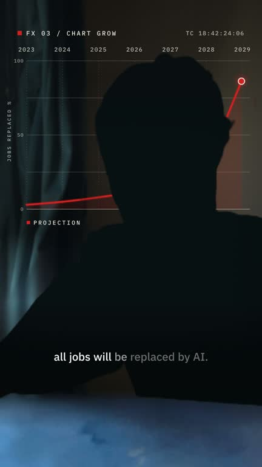
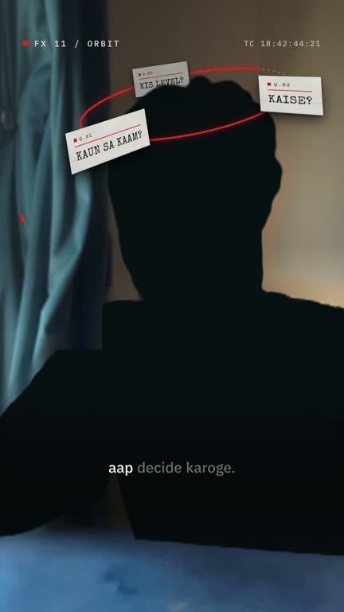
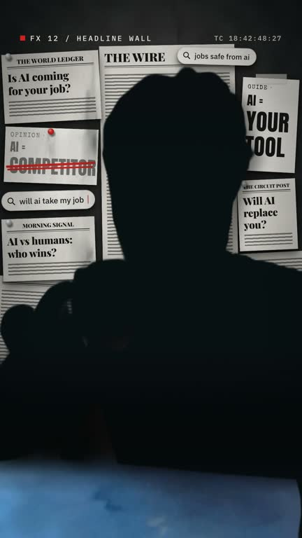
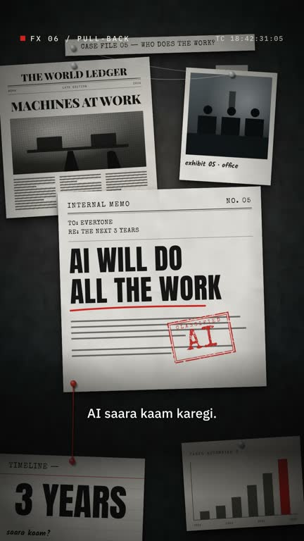
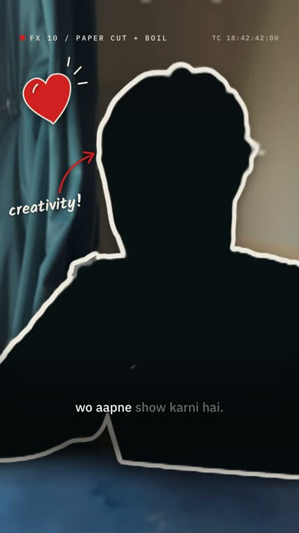
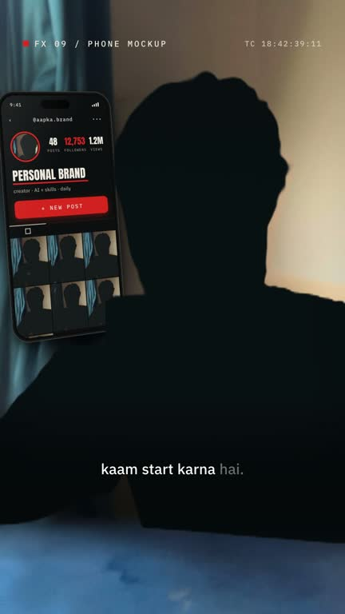
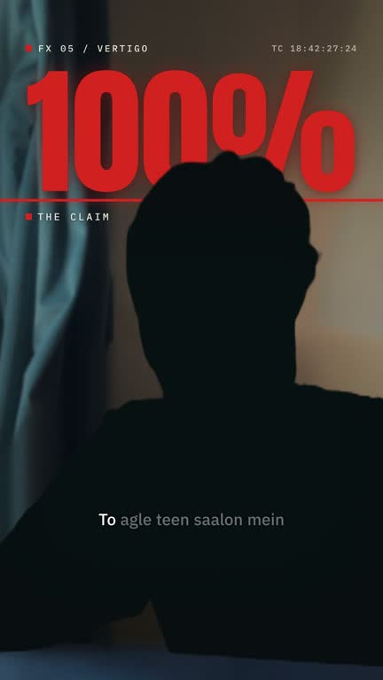

# Cinematic Reel: a Claude Code skill

**Turn one raw talking-head clip from your phone into a finished, premium reel with one prompt.**

You record yourself talking to the camera. Claude cleans your voice, cuts the retakes and silences, and hides the moments where you blinked or looked away. It then edits the clip into an investigative-documentary style reel and renders a 1080×1920 MP4 ready for Instagram, TikTok or YouTube Shorts.

It runs on [Claude Code](https://claude.com/claude-code) with [HyperFrames](https://hyperframes.heygen.com), which renders video from HTML. The style is fixed, so every reel you make looks like the same series.

**[See all 12 effects in motion →](https://aasim-shah.github.io/cinematic-reel-skill/#effects)**

| | | | |
|:---:|:---:|:---:|:---:|
| <br>Cover story | <br>Chart grow | <br>Orbit | <br>Headline wall |
| <br>Pull-back reveal | <br>Paper cut | <br>Phone mockup | <br>Vertigo |

<sub>The speaker is shown as a silhouette in these demos. In your reel it is you.</sub>

---

## Contents

- [Who it is for](#who-it-is-for)
- [What it does](#what-it-does)
- [Install](#install)
- [Make your first reel](#make-your-first-reel)
- [Customise it](#customise-it)
  - [Sound effects](#sound-effects)
  - [Video effects](#video-effects)
  - [Voice clean-up](#voice-clean-up)
  - [Music, text, colours and fonts](#music-text-colours-and-fonts)
- [What's in the repo](#whats-in-the-repo)
- [Troubleshooting](#troubleshooting)
- [Credits](#credits)

---

## Who it is for

- Creators who post talking-head reels and want an edited, "documentary" look without opening an editor.
- Anyone who records in one take with mistakes, restarts and pauses, and wants those cleaned up for them.
- Speech in English, Hindi, Urdu or Roman Urdu/Hindi. The style was built on iPhone footage recorded with a clip-on mic.

You need to be comfortable typing into Claude Code. You do not need to know video editing or code.

## What it does

Claude follows the same pipeline every time:

| Step | What happens |
|---|---|
| **Voice upgrade** | Measures your raw audio for mud, hiss, clipping, dull tone and a silent channel. Applies a voice chain: light denoise, EQ (less mud at 250 Hz, more clarity at 3.5 kHz, air at 9 kHz), de-esser, compression and −14 LUFS. Reports the numbers before and after. |
| **Retake removal** | Rebuilds your script from the transcript. If you said a line three times, it keeps the last clean take. Cuts false starts, restarts and fillers like "umm". |
| **Silence removal** | Removes dead air and long pauses. Each cut starts just before your first word and ends where the silence begins, with tiny audio fades so no cut clicks. |
| **Face check** | Looks at every frame for closed eyes, looking away, odd expressions and jump cuts. Each bad moment is covered by a full-screen evidence board while your voice keeps playing. |
| **The look** | A natural skin grade, cinema letterbox bars, film grain, a typed `FILE 01` case-file label with a running timecode, word-by-word subtitles, chapter titles with a red hand-drawn circle, and a giant word behind your head (AI cut-out of you). |
| **12 effects** | 3–6 creative effects per reel, each placed on a moment that matches what you say. See [Video effects](#video-effects). |
| **Sound design** | Whooshes, a camera flash on names, typing clicks, a stamp and a riser into the end, mixed under your voice. See [Sound effects](#sound-effects). |
| **Storyboard gate** | Before anything renders, Claude shows you a snapshot of every beat and waits for your OK. |
| **Render and verify** | Renders the MP4, then checks loudness, peaks and a contact sheet and reports honestly. |

The look uses one accent colour (signal red), Anton for titles, IBM Plex for the interface and subtitles, and Kalam and Tillana for handwritten notes.

## Install

### Requirements

| Need | Why | How |
|---|---|---|
| [Claude Code](https://claude.com/claude-code) | runs the skill | CLI, desktop app or VS Code extension |
| Node.js 18+ | HyperFrames runs with `npx hyperframes` | [nodejs.org](https://nodejs.org) |
| ffmpeg | audio and video processing | `brew install ffmpeg` |
| macOS | `prep-source.sh` uses Apple's `avconvert` to convert iPhone HDR video | On Windows or Linux, export your clip as SDR first |
| HyperFrames skills | the video engine (`/hyperframes`, `/hyperframes-core`, `/media-use`) | see the [HyperFrames docs](https://hyperframes.heygen.com) |
| ElevenLabs account (optional) | fast transcription for clips over ~40 s | local Whisper also works, but is slow |

### Add the skill

```bash
git clone https://github.com/aasim-shah/cinematic-reel-skill.git
mkdir -p ~/.claude/skills
cp -R cinematic-reel-skill/cinematic-reel ~/.claude/skills/
```

This makes the skill available in every project. To use it in one project only, copy the folder into that project's `.claude/skills/` instead.

No git? Download [`docs/cinematic-reel-skill.zip`](docs/cinematic-reel-skill.zip) and unzip it into `~/.claude/skills/`.

### Check it loaded

Open Claude Code in your video folder and type `/cinematic-reel`. If it shows up in the list, you are ready.

## Make your first reel

1. **Put your clip in your project folder.** A vertical phone video (`.mov` or `.mp4`) of you talking to the camera. 15–120 s works best.
2. **Ask Claude.** Mention the file with `@` so Claude can read it:

   ```
   @my-clip.mov edit this into a cinematic reel
   ```

   Other prompts that work:

   ```
   /cinematic-reel @take-02.mov, the message is "AI won't take your job, people using AI will"
   @raw.mov there are retakes and mistakes, cut them and hide bad faces with b-roll
   make the storyboard for @interview.mp4 but don't render yet
   ```

3. **Answer only what Claude can't work out.** The style is already decided, so there is no long interview. Claude may ask for your core message if the speech is unclear.
4. **Review the storyboard.** Claude stops and shows a table of every beat with a snapshot, the effect used and which bad moments are covered. Reply `looks good, render it`, or ask for changes, for example `swap the orbit for a chart grow` or `make the title on beat 3 shorter`.
5. **Get your video** at `videos/<name>/renders/<name>-final.mp4`: 1080×1920, 30 fps, about −14 LUFS, peaks below −1 dB.

Each reel is its own HyperFrames project in `videos/<name>/`. You can reopen it later and ask for edits.

## Customise it

You can do everything below by asking Claude in plain words. The manual steps are there if you want to know what changes.

### Sound effects

The template ships 7 sound effects in `cinematic-reel/template/assets/sfx/`:

| File | Where it plays | Volume |
|---|---|---|
| `click.mp3` | one click when a label starts typing (never one per letter) | 2.0 |
| `click-soft.mp3` | one tick when the red circle lands on a title word | 1.0 |
| `whoosh-short.mp3` | letterbox bars slide in or reopen; the red string draws | 0.55–0.85 |
| `woosh.mp3` | shutter closes to black; crash zoom on the board | 0.9–1.0 |
| `camera-flash.mp3` | a name appears; flash cut back to the face | 2.5 (fades out in 0.5 s) |
| `mech-click.mp3` | the rubber stamp hits the board | 3.5 |
| `riser-sharp.mp3` | the last second, into the end | 2.5 |

**Rule of thumb:** at most one click-type sound (click, tick, stamp) every 2 seconds. More than that sounds busy. Full map: `references/style.md`, section "Sound map".

**Swap a sound for your own.** Replace the file with one of the same name, in the template (every new reel) or in one project's `assets/sfx/` (that reel only). Keep it short and dry, with no music in it.

**Add a new sound.**

1. Copy the file into the project's `assets/sfx/` (or the template, to use it in every reel).
2. Ask Claude, for example: `add assets/sfx/swoosh-paper.mp3 on the paper tear at 12.4 s, under the voice`.
3. Or add it yourself in `index.html`, inside `#root`, on its own track:

   ```html
   <audio id="sfx-paper" src="assets/sfx/swoosh-paper.mp3"
          data-start="12.4" data-duration="0.8" data-track-index="14" data-volume="1.0"></audio>
   ```

**Get the volume right.** Many stock sound effects are very quiet (−24 to −30 LUFS), so they need a volume above 1 to be heard under speech. Sounds under speech need at least 0.75. The root has a master limiter (+1.5 dB, then −3 dBTP), so a loud effect never pushes your voice down. After rendering, check the render log for "Audio lowered". If you see it, lower the loudest effect.

**Avoid** meme sounds (vine boom, pop) and harsh metallic risers. They break the documentary tone.

### Video effects

| # | Effect | Use it when the line is about… | File |
|---|---|---|---|
| 1 | Cover story | the hook or the theme ("everybody is worried") | `fx/cover-story.html` |
| 2 | Frame break | content, reels, "you watching this" | `fx/frame-break.html` |
| 3 | Chart grow | a trend or a number with a direction | `fx/chart-grow.html` |
| 4 | Zoom-through cut | a transition joining two effects | `fx/zoom-through.html` |
| 5 | Vertigo | one shock claim (once per reel) | `fx/vertigo.html` |
| 6 | Pull-back reveal | a detail that widens to the big picture; also hides a bad take | `fx/pull-back.html` |
| 7 | Paper tear | a transition between chapters | `fx/paper-tear.html` |
| 8 | Couch wall | your own work, history or routine | `fx/couch-wall.html` |
| 9 | Phone mockup | posting, a profile, an app, a personal brand | `fx/phone-mockup.html` |
| 10 | Paper cut + doodle boil | creativity or personality | `fx/paper-cut.html` |
| 11 | Orbit | a list of 2–4 questions or options | `fx/orbit.html` |
| 12 | Headline wall | public fear, news, "what people say" | `fx/headline-wall.html` |

**Let Claude choose.** By default Claude picks 3–6 effects that match your lines, at most one every 6–8 seconds, and never two face effects back to back.

**Ask for a specific effect.**

```
use orbit on "kaun sa kaam, kaise, kis level"
put a chart grow on "by 2029" with the line ending at 100%
no vertigo in this one
```

**What happens when an effect is added.** Claude:

1. copies `fx/<name>.html` into the project's `compositions/fx/`;
2. mounts it in `index.html` at the right time;
3. makes a cut-out (matte) of you for that moment;
4. edits the effect's `CONFIG` block (texts, timings, positions);
5. adds its sound cues and snapshots it to check that your head stays in front and nothing covers the subtitles.

The full steps and pitfalls are in `references/effects.md`. Each effect also has a note in `fx/notes/<name>.md`.

**Change an effect's text or timing.** Every effect file has a commented `CONFIG` block at the top of its script. For example, in orbit you can change the three question cards and the word the red ring lands on. Ask Claude (`change the orbit cards to "kya", "kab", "kaise"`) or edit `CONFIG` in the project's copy.

**Create a new effect.**

1. Ask Claude to build it in the house style, for example: `make a new effect "checklist": three items tick off one by one beside my head on "pehla, doosra, teesra"`.
2. Claude builds it as `fx/<name>.html`, a HyperFrames sub-composition with a `CONFIG` block. It uses only the house palette and fonts, one paused GSAP timeline, and a unique id prefix.
3. To keep it for future reels, add a note in `fx/notes/<name>.md` and a row in the catalog table in `references/effects.md` (when to use it, how long, whether it needs a matte). Claude only uses effects listed in that catalog.

### Voice clean-up

The default chain in `scripts/prep-source.sh` is tuned for a clip-on mic (Hollyland Lark A1 Mini) into an iPhone. For a different mic or room, Claude measures the clip with `scripts/audio-qc.sh` and builds a custom chain:

```bash
VOICE_AF="highpass=f=80,afftdn=nf=-40,adeclick,deesser=i=0.6,loudnorm=I=-14:TP=-1.5" \
  bash ~/.claude/skills/cinematic-reel/scripts/prep-source.sh my-clip.mov videos/my-reel
```

Claude then makes three short files (raw, default chain, custom chain) for you to compare, and you pick one. If the audio is badly damaged (strong echo), it suggests Adobe Podcast "Enhance Speech" and uses the cleaned file.

**Recording tips that help most:** set the mic's noise cancellation to off or weak indoors, clip the mic 15–20 cm below your chin, and keep peaks around −6 to −12 dB.

### Music, text, colours and fonts

- **Background music.** The house style has no music bed, because the sound design carries it. To add one, put the track in `assets/` and ask: `add assets/bed.mp3 as a quiet music bed, ducked under my voice`. HyperFrames lowers the music while you speak.
- **Titles, notes and board text.** Ask for changes at the storyboard step. Titles stay on one line; Claude shrinks the size instead of wrapping.
- **Language.** Subtitles follow your speech. Mention the language if the transcript gets it wrong.
- **Colours, fonts, grade and motion.** These are locked in `references/style.md` so every reel matches. To create your own house style, edit that file (palette, type, grade JSON, motion values, sound map) and the matching CSS in `template/index.html`. Keep one accent colour; the style depends on it.
- **Handwriting.** Only Kalam (pen notes) and Tillana (expressive words). To use another hand, replace the font files in `template/assets/fonts/` and update `style.md`.

## What's in the repo

```
cinematic-reel/                  the skill (copy this into ~/.claude/skills/)
├── SKILL.md                     the workflow Claude follows
├── references/
│   ├── style.md                 palette, type, grade, motion, sound map (locked)
│   ├── modules.md               the 5 beat modules and how to scale to 30–120 s
│   ├── effects.md               the 12-effect catalog and integration rules
│   └── qc.md                    voice and face checks, recording tips, render notes
├── fx/                          the 12 effects, their notes and matte tools
├── scripts/
│   ├── new-project.sh           creates videos/<name>/ from the template
│   ├── audio-qc.sh              voice quality report
│   └── prep-source.sh           HDR to SDR, 1080×1920 at 30 fps, voice clean-up
└── template/                    the approved sample as a working HyperFrames project
    ├── index.html               main timeline (all beat modules)
    ├── compositions/board.html  the evidence board
    ├── storyboard-template.html the approval page
    └── assets/                  fonts, textures, sound effects
docs/                            landing page (GitHub Pages) and the skill zip
```

The template does not include the sample's footage (`assets/take.mp4`, the cut-out and an audio file). Each new reel makes its own from your clip.

## Troubleshooting

| Problem | Fix |
|---|---|
| `/cinematic-reel` doesn't show up | Check that the folder is at `~/.claude/skills/cinematic-reel/SKILL.md` (not nested one level deeper), then restart Claude Code. |
| Render is very slow | Render from the CLI, not the Studio preview, and only one render at a time. |
| The voice is quieter than expected | Look for "Audio lowered by X dB" in the render log. A loud sound effect is too hot; lower its volume. |
| The video freezes for a moment | The source needs a keyframe every second. `prep-source.sh` already does this; re-encode any other clip with `-g 30 -keyint_min 30`. |
| A ghost of the background shows inside the giant word | The cut-out picked up part of the room. Ask Claude to clean the matte or move the word. |
| The giant word behind the head can't be read | The head fills the top of the frame. Ask Claude to skip the behind-head word for that clip. |

## Credits

- Fonts under the [SIL Open Font License 1.1](https://openfontlicense.org): Anton, IBM Plex Sans, Special Elite, Kalam and Tillana.
- Video engine: [HyperFrames](https://hyperframes.heygen.com) by HeyGen. Animation: GSAP.
- Built by [@aasim-shah](https://github.com/aasim-shah) with Claude Code.
